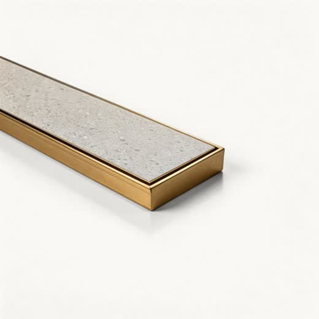
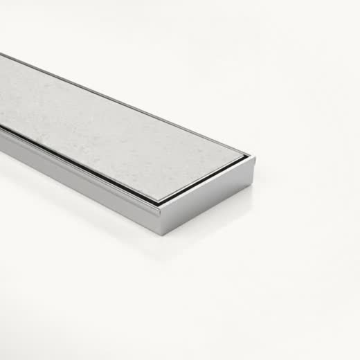
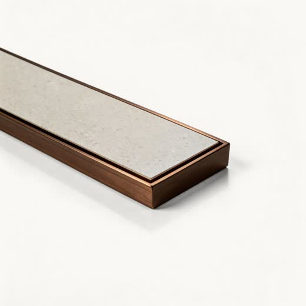
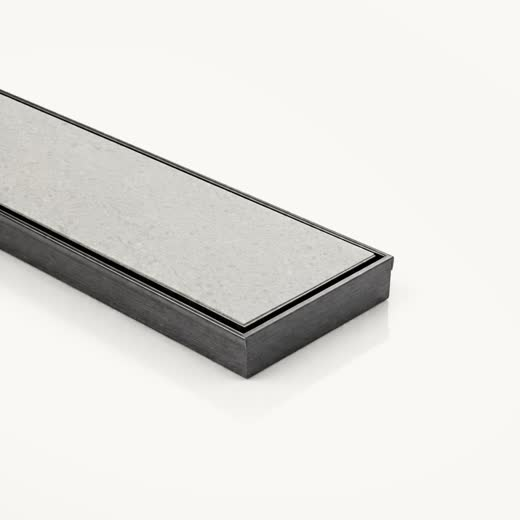
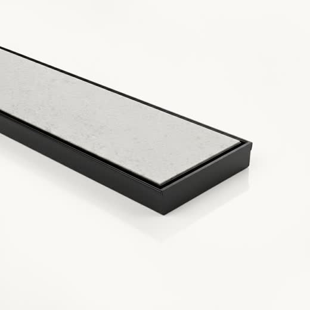
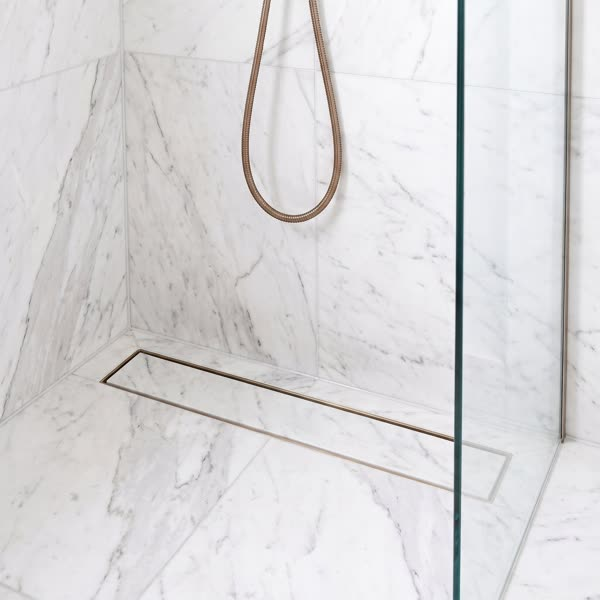

Storyboard v2 · for review before build

# Neston: All of the Drain, None of the Drama

A 30-second vertical reel in the style of the Bios Life "None of the Bull" ad: dry voiceover, heavy type that builds word by word, cut-out vintage imagery as punchlines, one rubber-stamp gag and whip-blur cuts. Rebuilt in Neston's palette, using Neston's real product photos and only the proof points in BRAND.md.

**30 s** · 10 scenes**1080×1920** · 9:16 · 30 fps VO **James – Australian** (house voice)Audience **trade + specifiers** (Phase 1) CTA **Ask your reseller**

### Approved exception: on-screen text allowed for this video

BRAND.md (15 Nov 2026) says Neston videos carry no on-screen text. The owner overrode that rule for this reel on 27 Nov 2026, so the kinetic type stays. The rule still applies to the regular weekly reels.

## What we're taking from the reference

**Textured ground**

Their blue-grey grunge paper becomes a warm concrete-screed texture with a heavy vignette and a faint brass tint.

**Type that builds**

Huge condensed ink capitals land word by word with the VO. Size jumps carry the joke: small setup, giant payoff.

**Cut-out punchlines**

Vintage engravings and postcards dropped in flat, with no shadows. Public-domain or licensed only, and no recognisable real people.

**One stamp gag**

Their red "STUPID" becomes a red "WISHFUL THINKING". It mocks the spec decision, never the viewer.

**Whip-blur cuts**

Directional motion blur between beats, with the product spinning out on the tagline.

**Deadpan voice**

Fast and dry, never shouty. That also keeps us inside Neston's calm voice: no hype words, no exclamation marks.

## Scenes

You want

A drain?

0:00.0 – 0:02.5

### 1 · Hook

You want a drain?

On screen

"YOU WANT" small, then "A DRAIN?" slams in huge.

Motion

Hard cut in from black frame 0. Each word snaps in with a slight overshoot. A slow 3% push-in holds through the scene.

Sound

Music kicks in on frame 1. A low thud lands on "drain".

How about an

Architectural

Drain

0:02.5 – 0:05.0

### 2 · The pitch

How about an architectural drain…

On screen

"HOW ABOUT AN" / "ARCHITECTURAL" / "DRAIN", stacked as the words are spoken.

Motion

Lines type on from the left with a short motion trail, like the reference's "How about smart energy".

Public-domain engraving:\
Roman sewer arch\
(Cloaca Maxima, 1700s etching)

Not that

kind.

0:05.0 – 0:07.0

### 3 · "Not that type" gag

…no. Not that kind.

On screen

"NOT THAT KIND." over an old engraving of a Roman sewer, since the Romans did "architectural drains" first.

Motion

The engraving slides up from the bottom edge as a flat cut-out. The type punches on "kind".

Ref beat

Bios Life's wind turbines under "Not that type".

NESTON

The

316

Stainless steel\
drain

0:07.0 – 0:10.5

### 4 · Hero reveal

Neston. The three-sixteen stainless steel drain.

On screen

The NESTON wordmark runs vertically up the left edge, as Bios Life does. "THE / 316 / STAINLESS STEEL DRAIN" builds beside it.

Visual

Real photo: the brushed brass 1200mm tile insert kit, set into the paper like it's sitting in a screed bed.

Motion

The kit rises into place on "Neston". At the end, everything whips off to the right with motion blur.

Proof point

#1 in BRAND.md: 316 across the whole range.

Plenty of drains are

304.

Fine.

If everyone\
cleans up.

Vintage cleaning illustration:\
scrub brush and bucket\
(PD / licensed)

0:10.5 – 0:14.0

### 5 · Roast the alternative

Plenty of drains are three-oh-four. Which is fine… if everyone cleans up properly.

On screen

A giant "304." then "FINE." then "IF EVERYONE CLEANS UP." Soap suds and a few loose hairs creep across the frame as the illustration drops in.

Motion

The suds spread organically over about 1 second. The illustration drops in with a little paper flutter.

Ref beat

"9 donuts" and "Toledo", where the joke lands on the competitor.

Claim check: no brand is named. 304 is described as fine with proper care, and 316 is not claimed to be bleach-proof or maintenance-free. The compliance reviewer signs off on this line before build.

Counting on that

is just…

Wishful\
thinking

0:14.0 – 0:17.0

### 6 · The stamp

Counting on that is just…

On screen

The line builds, then a red "WISHFUL THINKING" rubber stamp slams across it on the pause.

Motion

The stamp scales from 140% to 100% in 3 frames with a 2-frame camera shake. The ink texture stays grainy.

Sound

A stamp thunk. The music drops out for half a beat.

Ref beat

"Drinking anything else is just… STUPID".

We've got

Five

matched\
finishes

   

0:17.0 – 0:21.0

### 7 · The brag

We've got five matched finishes. Stainless, brass, bronze, gun metal… and black.

On screen

"WE'VE GOT FIVE MATCHED FINISHES". Five real kit photos stack in, one on each finish name, and a swatch pops for each.

Motion

Kits drop in on the beat, about 0.35 s apart, with a small bounce on each.

Proof point

#2 in BRAND.md: five matched PVD finishes.

Ref beat

"We've got matcha, hand harvested…".

I'm so proud.

Vintage illustration:\
1950s tradesman\
with spirit level\
(PD / licensed)

Cut to size

on site

0:21.0 – 0:24.5

### 8 · Make your plumber proud

Kits you cut to size on site. Your plumber will be so proud.

On screen

"CUT TO SIZE ON SITE" under a vintage tradesman illustration with an "I'm so proud." speech bubble.

Motion

A saw-cut wipe slices "CUT TO SIZE" in two, then it snaps back. The bubble pops on "proud".

Proof point

#3 in BRAND.md: cut-to-size kits with a loose outlet and end caps.

Ref beat

"Make your mother proud".

Use an illustration rather than a photo of a real person. The reference used Wernher von Braun, and the brief rules out recognisable people without permission.

All of the

Drain

None of the

Drama

0:24.5 – 0:27.0

### 9 · Tagline

All of the drain. None of the drama.

On screen

"ALL OF THE DRAIN" above the brass kit, "NONE OF THE DRAMA" below.

Motion

The kit and type lock up, hold for 1 s, then the whole group spins and whip-blurs away, exactly like the reference's "All of the energy, none of the crash".

 

Available through Neston resellers\
neston.com.au

0:27.0 – 0:30.0

### 10 · End card

Neston. Ask your reseller.

On screen

The large Neston logo in ink on the marble wall of a walk-in shower, with the brushed bronze linear drain along the floor below it. "Available through Neston resellers · neston.com.au" sits under the logo.

Why not black

The reference ends on a black URL card, but the owner rejected dark blocks and grey fallback end cards, so we use the installed photo as the brief asks.

Motion

A slow 4% push-in toward the drain while the logo fades up.

Sound

The music resolves on the logo, with a clean ending.

Phase 1: no price and no "buy now". The CTA points to resellers.

## Full voiceover script

You want a drain? How about an architectural drain… no. Not that kind. Neston. The three-sixteen stainless steel drain. Plenty of drains are three-oh-four. Which is fine… if everyone cleans up properly. Counting on that is just… \[stamp\]. We've got five matched finishes. Stainless, brass, bronze, gun metal… and black. Kits you cut to size on site. Your plumber will be so proud. All of the drain. None of the drama. Neston. Ask your reseller.

73 words in 30 s, which is fast and deadpan like the reference. If James can't hold that pace cleanly, cut scene 3's "no." and "Which is".

## Brand checks

| Rule (BRAND.md) | How this storyboard handles it | Status |
| --- | --- | --- |
| No on-screen text on videos | Overridden by the owner for this reel (27 Nov 2026). | Approved |
| Calm, technical voice; no hype or exclamation marks | The humour is dry and has no superlatives. Real numbers (316, 304, five finishes) carry the brag. | Owner taste call |
| Only listed proof points | Uses #1 (316), #2 (five PVD finishes) and #3 (cut-to-size kits). No warranty, no WaterMark claim, no flow or slip figures. | OK |
| 304 vs 316 comparison | Generic grade comparison with no competitor named. Urban-use angle. Check it against the Journal post. | Compliance review |
| Phase 1: no prices, no direct buy | The CTA is "Ask your reseller". | OK |
| Real product photos, no renders or AI product footage | All product shots come from neston.com.au. Vintage props are public-domain or licensed. | OK |
| No identifiable people without permission | Illustrations and engravings only. | OK |
| Installation by a licensed plumber | The VO already says "your plumber". The caption adds "Install by a licensed plumber". | OK |

## Build plan once approved

1. **Compliance pass** on the script and on-screen text (neston-compliance-reviewer).
2. **Voiceover:** ElevenLabs, house voice James – Australian, read deadpan. Scenes are cued to the VO's silences.
3. **Music:** a Runway instrumental, punchier than the usual architectural bed (about 120 BPM, driving drums and bass, with a drop-out for the stamp). Kept at least 6 dB under the voice.
4. **Props:** source the public-domain Roman sewer engraving, cleaning illustration and tradesman illustration, and check each licence.
5. **Build** as a HyperFrames (HTML/GSAP) composition at 1080×1920, because the current make_reel.py can't do kinetic type. Then render the MP4 and a cover frame.
6. **Hand-over:** MP4, cover, Instagram/Facebook and LinkedIn captions, and alt text. The owner posts.

Type option: the frames use Anton for the reference's condensed punch. Montserrat ExtraBold stays closer to the Neston site but reads wider and less "shouty". Anton is my pick for this piece.